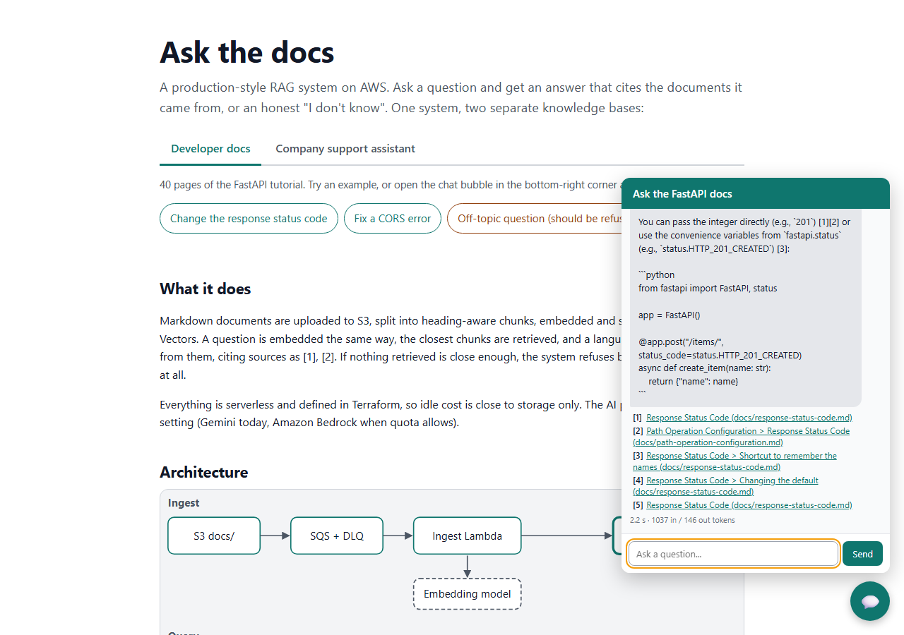
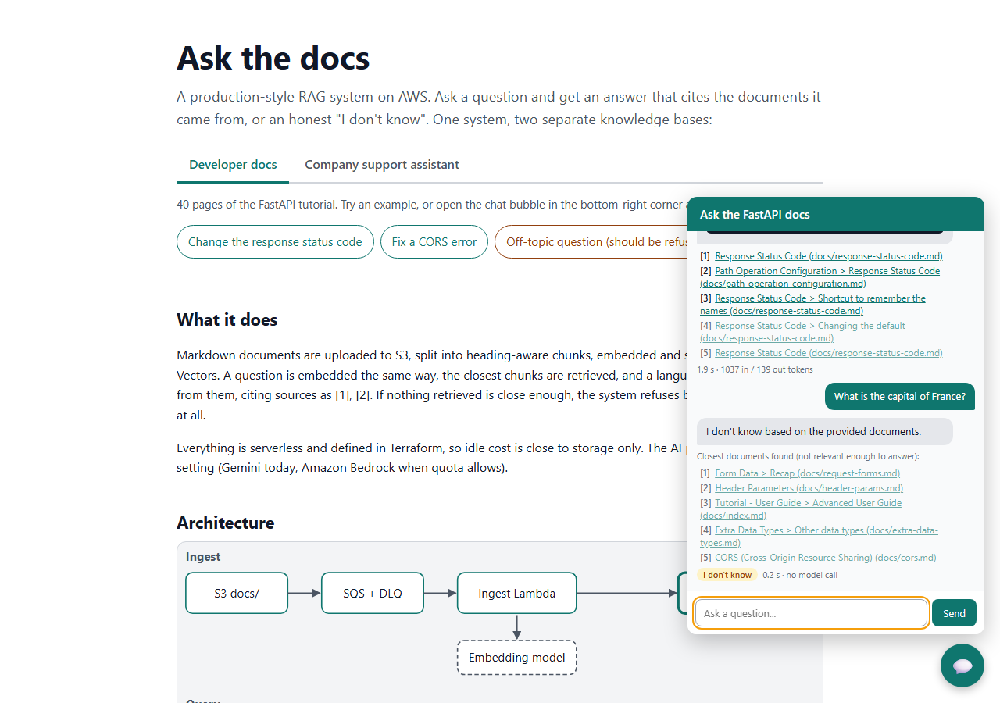
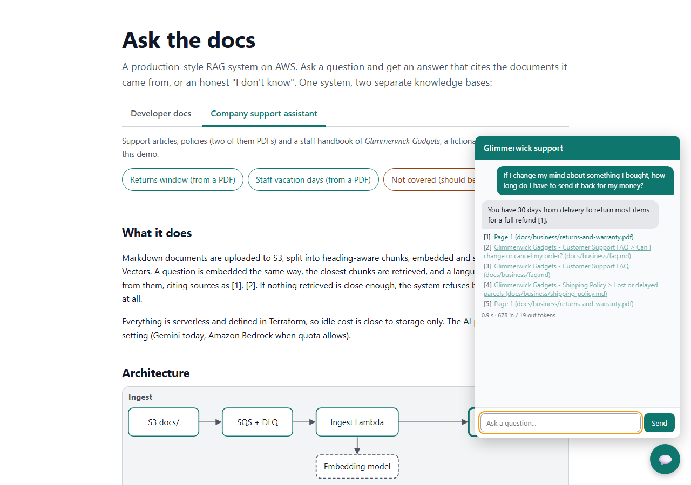
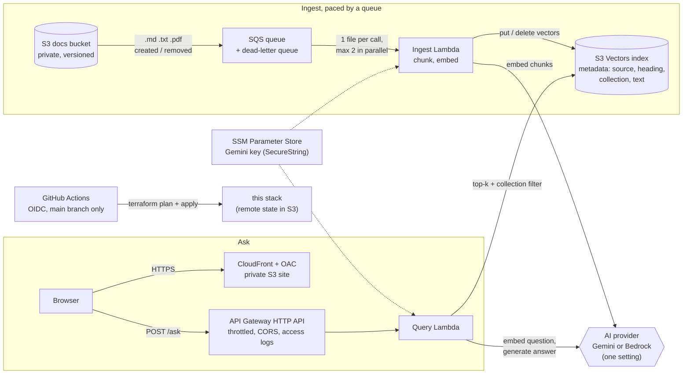

# rag-on-aws

**A serverless RAG system on AWS: upload Markdown, text or PDF files, ask questions, get answers that cite their sources, or an honest "I don't know". One `terraform apply`, measured quality, and a published cost per 1,000 questions.**

**Live demo: <https://d2663er6f5q1m4.cloudfront.net>**: two knowledge bases to try (FastAPI docs, and a fictional company's support articles, policies and staff handbook).

| Answer with sources | Refusal | Company assistant (PDF sources) |
|---|---|---|
|  |  |  |

## Architecture



**Flow.** A file lands in `docs/` → S3 notifies an SQS queue → the ingest Lambda (concurrency capped at 2) splits it into heading-aware chunks, embeds them and writes them to S3 Vectors with deterministic keys (`<s3 key>#<n>`), so re-uploads overwrite and deletes clean up. A question goes through API Gateway to the query Lambda, which embeds it, retrieves the top 5 chunks (optionally within one *collection*), refuses before calling the model if nothing is close enough, and otherwise asks the model to answer **only** from the numbered sources.

## Key decisions

| Decision | Why |
|---|---|
| Own ingest/query Lambdas + **S3 Vectors**, not managed Knowledge Bases | Cheap at rest (no always-on cluster), fully explainable, every step testable |
| **Pluggable AI provider** (`gemini` or `bedrock`, one Terraform variable) | Bedrock on-demand quota was 0 on this new account; the same code runs on either |
| Plain Python + `boto3`; Gemini over `urllib`; `pypdf` vendored | No LangChain/LlamaIndex/Google SDK: a 0.4 MB zip anyone can read end to end |
| **SQS between S3 and the ingest Lambda** | Uploading 40 files started 40 parallel Lambdas and tripped free-tier rate limits; the queue paces them and retries |
| **Distance threshold 0.4, tuned from evals** | The default 0.6 never fired with Gemini embeddings; the eval sweep showed 0.4 is safe (0 wrong refusals) |
| **Collections** (`docs/<name>/…`) as filterable metadata | One index serves several knowledge bases; `/ask` takes an optional `collection` |
| Terraform module + demo env, **remote state** with native lockfile | Reusable for client work; no DynamoDB table needed |
| **CD with GitHub OIDC**, no stored AWS keys | Short-lived credentials, trust limited to this repo's `main` branch |

## Evaluation

40 + 10 hand-reviewed questions (answerable, multi-document, off-topic and near-miss), run against the live API. Full table, method and per-run notes: [`evals/RESULTS.md`](evals/RESULTS.md). Question format and how the sets were made: [`evals/README.md`](evals/README.md).

@@EVAL@@

## Cost per 1,000 questions

Measured token usage from the eval runs (average @@TOKENS@@ per question, including the questions refused before the model), multiplied by official prices checked on 2026-11-25.

@@COST@@

Sources: [Gemini API pricing](https://ai.google.dev/gemini-api/docs/pricing) · Amazon Bedrock on-demand prices for us-east-1 from the [AWS Price List API](https://docs.aws.amazon.com/awsaccountbilling/latest/aboutv2/price-changes.html) (published 2026-11-23; the same figures as the [Bedrock pricing page](https://aws.amazon.com/bedrock/pricing/)) · [Lambda](https://aws.amazon.com/lambda/pricing/) · [API Gateway](https://aws.amazon.com/api-gateway/pricing/) · [S3 Vectors](https://aws.amazon.com/s3/pricing/). Reproduce with `python scripts/estimate_cost.py evals/results/<run>.json`. Idle cost is storage only: a few cents per month for this demo.

## Security

- **Least-privilege IAM.** Each Lambda role holds only the actions it uses, scoped to specific ARNs (one bucket prefix, one vector index, one queue, one SSM parameter, its own log group). No wildcard actions.
- **Permissions boundary** on both Lambda roles: a hard ceiling (`infra/bootstrap/boundary.tf`). The CD deploy role may create or change stack roles *only* if they carry it, and is denied changing boundaries, its own role or its own policies, so a compromised branch cannot mint a more powerful role.
- **Private everything.** Docs, vector, state and website buckets block public access and use encryption; the site is served only through CloudFront with Origin Access Control, HTTPS-only, with CSP, HSTS and frame headers.
- **API.** Throttled at 2 requests/s (burst 5), question limited to 500 characters, CORS restricted to the CloudFront origin plus a configurable list, access logs (no client IPs) with 14-day retention.
- **No secrets in code, Terraform, tfvars or state.** The Gemini key lives only in SSM Parameter Store and is read at runtime. CI uses GitHub OIDC: no long-lived AWS keys, and the budget email is a masked secret.
- **Deploy guard.** The CD job refuses any plan that deletes or replaces resources unless the commit says `[allow-destroy]`.
- **Data privacy.** Free-tier Gemini may use prompts to improve Google products: use it for public or demo documents only. For client data use a paid Gemini key or the Bedrock provider.

## Problems solved

1. **Bedrock quota was 0.** AWS denied the increase for the new account, so the AI calls became a provider interface (`app/common/providers.py`) with Gemini and Bedrock implementations. Switching is one setting plus a re-ingest.
2. **Free-tier rate limits (HTTP 429).** 40 parallel ingests lost 11 documents after all retries. S3 → SQS → Lambda with capped concurrency, backoff with jitter, partial-batch failure reporting and a dead-letter queue fixed it.
3. **A threshold nobody tuned.** The first eval run showed the 0.6 distance threshold never triggered (off-topic questions scored 0.47–0.50). Sweeping thresholds over the eval set picked 0.4 with no wrongly refused question.
4. **GitHub OIDC refused the deploy role.** The repository uses GitHub's *immutable subject claims* (`repo:owner@id/repo@id`), so the trust policy had to match the ID-based subject, which is also safer against repo-name reuse.
5. **The refusal classifier lied.** Early eval numbers credited the threshold for refusals the model had made itself; refusals are now classified by whether tokens were spent.

## Deploy your own

Needs an AWS account (region `us-east-1`), Terraform ≥ 1.10, Python 3.12 and a [Gemini API key](https://aistudio.google.com/apikey).

1. **Store the key** (never in code or tfvars):
   `aws ssm put-parameter --name /rag-demo/gemini-api-key --type SecureString --value <key>`
2. **Bootstrap** (state bucket, GitHub OIDC provider, deploy role, boundary). Set `github_repo` / `github_sub_prefix` to your repository first:
   `cd infra/bootstrap && terraform init && terraform apply`
3. **Configure the stack:** copy `infra/envs/demo/terraform.tfvars.example` to `terraform.tfvars` and `backend.hcl.example` to `backend.hcl` (state bucket name from step 2), then:
   `scripts/build_lambdas.sh` (PowerShell: `.\scripts\build_lambdas.ps1`) → `cd infra/envs/demo && terraform init -backend-config=backend.hcl && terraform apply`
4. **Upload documents** (paced by the queue; allow a few minutes on the Gemini free tier):
   `aws s3 cp sample-docs s3://<docs_bucket_name>/docs/ --recursive`
5. **Ask:** `curl -X POST "$(terraform output -raw ask_url)" -H "content-type: application/json" -d '{"question":"How do I return an item?","collection":"business"}'`
6. **Open the site:** `terraform output web_url`.
7. **Continuous deployment:** set the repository variables `AWS_DEPLOY_ROLE_ARN`, `AWS_REGION`, `TF_STATE_BUCKET`, `GEMINI_GENERATION_MODEL` and the secret `BUDGET_ALERT_EMAILS`; every push to `main` then runs checks, plans and applies.
8. **Measure it:** `python evals/run_evals.py --url <ask_url> --collection fastapi` (and `--questions evals/questions_business.jsonl --collection business`).

## Repository layout

```
app/common/    chunking, documents (md/txt/pdf), providers (Gemini + Bedrock), clients, config
app/ingest/    SQS/S3 event -> chunk -> embed -> S3 Vectors      app/query/  POST /ask handler
infra/modules/rag_stack/   the reusable stack      infra/envs/demo/   this deployment
infra/bootstrap/           state bucket, OIDC, deploy role, permissions boundary
web/           demo site and the embeddable chat widget (no framework, no build step)
evals/         question sets, runner, results      sample-docs/   demo documents
scripts/       build, index check, cost estimate, browser test
```

## Credits and licences

Demo content for the developer collection is the [FastAPI tutorial](https://github.com/fastapi/fastapi) (MIT, © Sebastián Ramírez). *Glimmerwick Gadgets* is a **fictional company** invented for the demo; any resemblance to a real business is coincidental. The chat widget is adapted from the author's earlier `ai-support-widget` project (MIT).
